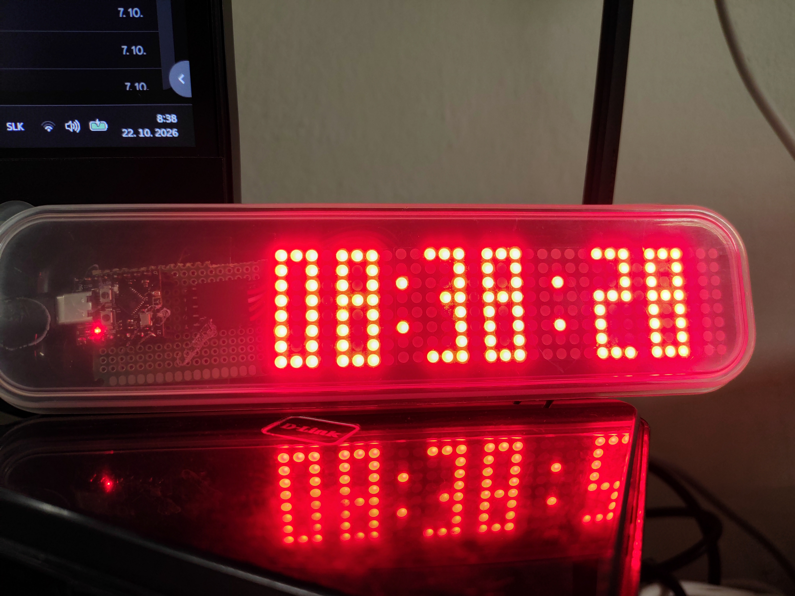
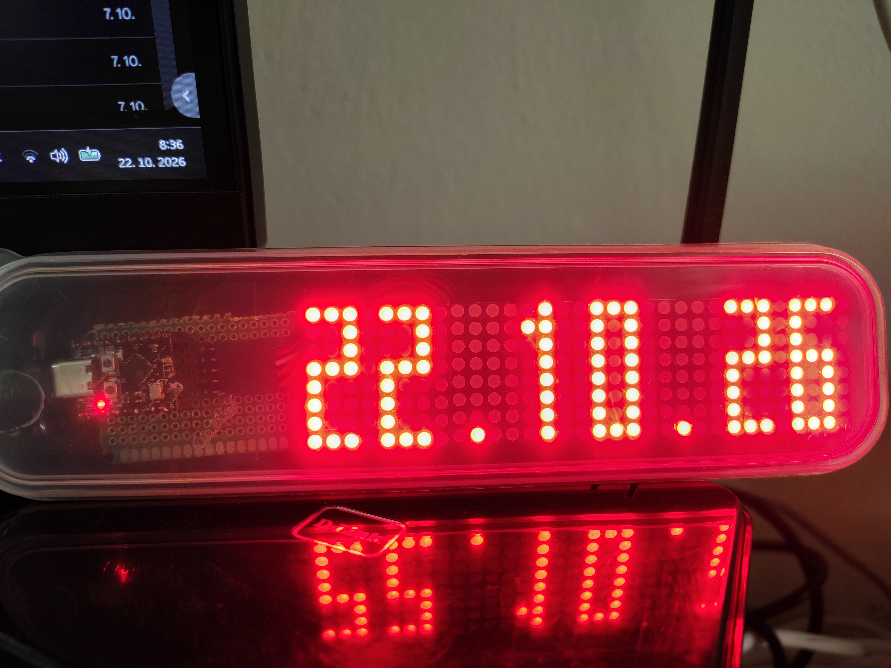

# ESPHome-Matrix-Clock
A digital clock built with an ESP32-C3 and four MAX7219 LED matrix modules. The display shows the current time, date, and full weekday name in a repeating sequence.





## Features

- Digital clock in `HH:MM:SS` format
- Date in `DD.MM.YY` format
- Full English weekday name with horizontal scrolling
- Automatic time synchronization using NTP
- Scheduled Wi-Fi activation four times per day
- Wi-Fi disabled after successful time synchronization
- Animated horizontal transitions between screens
- Custom bitmap font for digits and supported letters
- ESPHome firmware using the ESP-IDF framework

## Hardware

| Component | Description |
|---|---|
| Microcontroller | ESP32-C3 DevKitM-1 |
| LED display | 4 × MAX7219 LED matrix modules |
| Display resolution | 32 × 8 pixels |
| Communication interface | SPI |
| Firmware platform | ESPHome |
| Framework | ESP-IDF |

## GPIO Pinout

| ESP32-C3 GPIO | Function |
|---|---|
| GPIO6 | SPI MOSI / DIN |
| GPIO7 | SPI CLK |
| GPIO10 | MAX7219 chip select (CS) |

## ESPHome Configuration

The project uses the ESP32-C3 DevKitM-1 with the ESP-IDF framework.

```yaml
esphome:
  name: matrixclock
  friendly_name: Matrix Clock

esp32:
  board: esp32-c3-devkitm-1
  framework:
    type: esp-idf
```


## Custom Display Rendering

The display uses a custom C++ lambda to render every pixel on the 32 × 8 LED matrix. Instead of using a standard text font, the clock uses custom bitmap patterns for digits, punctuation, and supported letters.

### Custom Digit Bitmap

Each digit is represented by three columns of 8 bits. Every bit determines whether an individual LED pixel is enabled.

```cpp
const uint8_t digits[10][3] = {
  {0xFF, 0x81, 0xFF},
  {0x02, 0xFF, 0x00},
  {0xF9, 0x89, 0x8F},
  {0x81, 0x89, 0xFF},
  {0x1F, 0x10, 0xFC},
  {0x8F, 0x89, 0xF9},
  {0xFF, 0x89, 0xF9},
  {0x01, 0xF1, 0x0F},
  {0xFF, 0x89, 0xFF},
  {0x9F, 0x91, 0xFF}
};
```

### Rendering Functions

The lambda contains several functions responsible for drawing the display:

| Function | Purpose |
|---|---|
| `glyph()` | Returns bitmap data for supported digits, letters, and punctuation |
| `clock_pixel()` | Calculates pixels for the current time |
| `date_pixel()` | Calculates pixels for the date |
| `day_pixel()` | Calculates pixels for the scrolling weekday name |
| `screen_pixel()` | Selects the pixel-rendering function for the active screen |

### Animation and Screen Timing

The display cycles through three screens using a 12-second repeating sequence:

```cpp
uint32_t phase = millis() % 12000;

if (phase < 7000) {
  screen = 0;
  local = phase;
} else if (phase < 9000) {
  screen = 1;
  local = phase - 7000;
} else {
  screen = 2;
  local = phase - 9000;
}
```
## Display Sequence
| Screen | Content | Display Duration |
|---|---|---:|
| 0 | Time (HH:MM:SS) | 7 seconds |
| 1 | Date (DD.MM.YY) | 2 seconds |
| 2 | Weekday name | 3 seconds |

The complete cycle repeats every 12 seconds. Each screen transition uses an 800 ms horizontal animation.
Each screen transition uses an 800 ms horizontal animation. The weekday name scrolls across the display during its dedicated screen.

### Pixel Output

The display is cleared before each rendering update. The lambda then calculates the state of every pixel and lights the corresponding LED when required.

```cpp
it.fill(Color::BLACK);

for (int x = 0; x < 32; x++) {
  for (int y = 0; y < 8; y++) {
    // Calculate pixel state and render the result.
  }
}
```

The complete rendering implementation, including the font definitions, date and time formatting, scrolling logic, and animations, is available in [ESPHome Matrix clock full yaml.txt](https://github.com/ukiddingbitch/ESPHome-Matrix-Clock/blob/main/ESPHome%20Matrix%20clock%20full%20yaml.txt).


### Time Synchronization

The clock uses the `Europe/Bratislava` time zone and synchronizes with public NTP servers.

```yaml
time:
  - platform: sntp
    id: sntp_time
    timezone: Europe/Bratislava
    servers:
      - 1.sk.pool.ntp.org
      - pool.ntp.org
    update_interval: 1min
```

The time is checked every minute. After successful synchronization, Wi-Fi is disabled to reduce power consumption.

### Scheduled Wi-Fi Operation

Wi-Fi is enabled at 00:00, 06:00, 12:00, and 18:00.

```yaml
on_time_sync:
  then:
    - logger.log: "NTP: TIME SYNCHRONIZED, DISABLING WI-FI"
    - wifi.disable:
```

Each scheduled connection uses the following automation pattern:

```yaml
on_time:
  - seconds: 0
    minutes: 0
    hours: 6
    then:
      - logger.log: "NTP: SCHEDULED CONNECTION AT 06:00"
      - wifi.enable:
```

The same pattern is configured for midnight, noon, and 18:00.

**Note:** The schedule enables Wi-Fi; it does not itself guarantee that NTP synchronization will succeed. The device needs a working network connection and an available NTP server.

### Wi-Fi Configuration

```yaml
wifi:
  ssid: !secret wifi_ssid
  password: !secret wifi_password
  fast_connect: false
  power_save_mode: none
  reboot_timeout: 0s
```

Replace the example access point password with a secure password before deploying the device. The fallback access point is not the same as the normal Wi-Fi connection.


The three screens repeat in a 12-second cycle. Each screen transition uses an 800 ms horizontal animation.

The time separators blink every second. The weekday name scrolls horizontally across the display.

## Custom Font

The display uses a custom bitmap font defined in the C++ lambda. Digits are stored as three-column bitmap patterns, while punctuation and letters are implemented using individual character definitions.

This approach allows the display layout and animations to be controlled directly without relying on a standard text-rendering font.
